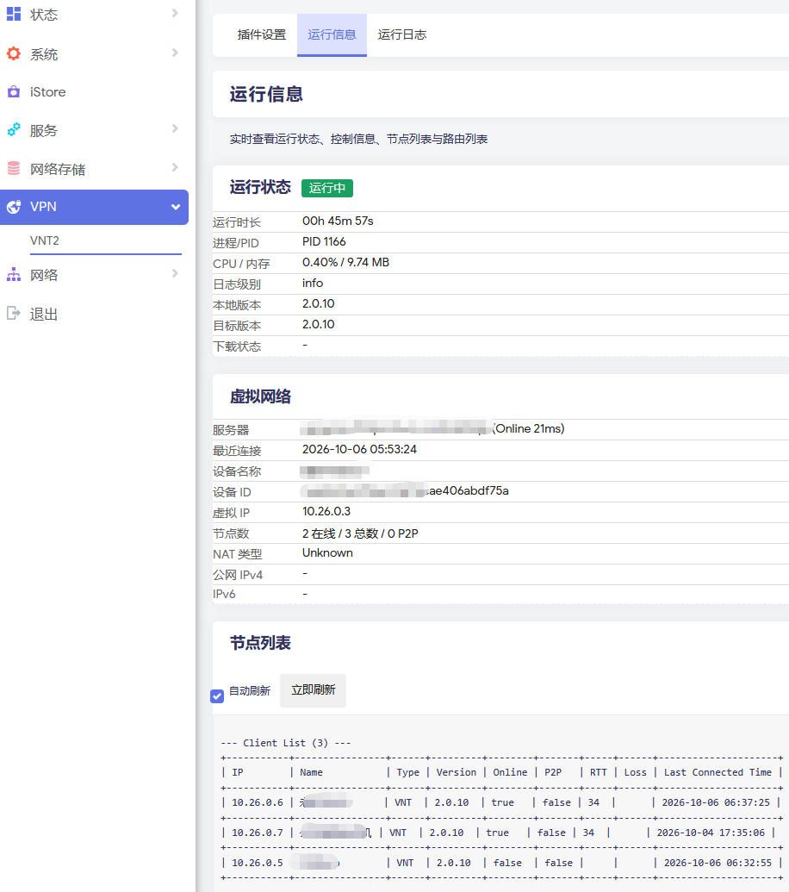
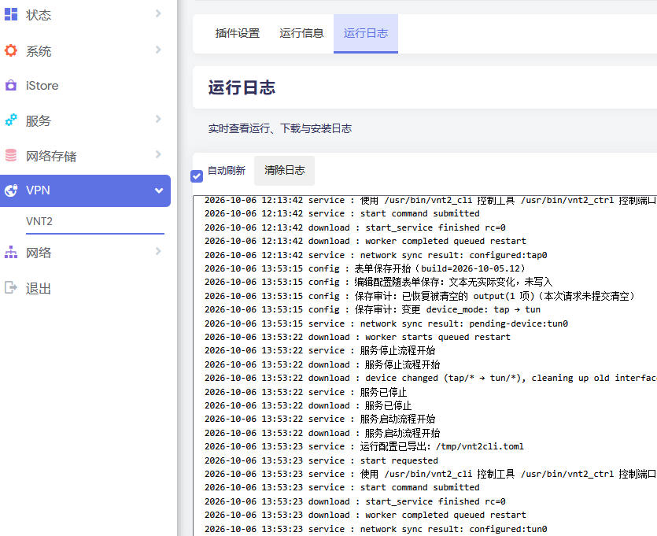

# luci-app-vnt2cli

OpenWrt LuCI 插件，用于管理 VNT2 命令行客户端 `vnt2_cli` 与控制工具 `vnt2_ctrl`。

## 功能

- 图形化配置 VNT2 客户端全部参数。
- 支持直接编辑 TOML 文本配置。
- 实时查看运行状态、节点列表与运行日志。
- 支持手动上传 `vnt2_cli` / `vnt2_ctrl` 二进制或压缩包。

## 界面截图

### 插件设置


### 运行信息



### 运行日志



## 文件说明

| 路径 | 说明 |
|------|------|
| `/etc/config/vnt2` | UCI 配置文件，唯一配置来源。 |
| `/tmp/vnt2cli.toml` | 运行时配置，由 init 脚本从 UCI 导出，每次启动重新生成，直接编辑无效。 |

## 安装

### OpenWrt 24.10.x（IPK）

系统 → 软件包 → 上传软件包，安装即可；或 SSH 执行：

```sh
opkg update && opkg install /tmp/luci-app-vnt2cli_<版本>-all.ipk
```

### OpenWrt 25.12.x（APK）

Release 发布的 `.apk` 由 SDK 自编译构建，未使用官方签名密钥，属于未签名包，安装和后续升级都需要 `--allow-untrusted` 参数。将 APK 上传到路由器 `/tmp/` 后通过 SSH 执行：

```sh
apk --update-cache add --allow-untrusted /tmp/luci-app-vnt2cli_<版本>-all.apk
```

> 注意：LuCI 软件包上传页面不会自动添加 `--allow-untrusted` 参数，APK 请通过 SSH 安装。

## 卸载

### OpenWrt 24.10.x

```sh
# ===== OpenWrt 24.10 (opkg) 卸载 luci-app-vnt2cli =====
# ---------- 1. 停止并禁用服务 ----------
/etc/init.d/vnt2-upload-worker stop 2>/dev/null; /etc/init.d/vnt2-upload-worker disable 2>/dev/null
/etc/init.d/vnt2-worker        stop 2>/dev/null; /etc/init.d/vnt2-worker        disable 2>/dev/null
/etc/init.d/vnt2               stop 2>/dev/null; /etc/init.d/vnt2               disable 2>/dev/null
# ---------- 2. 用 opkg 正常卸载（IPK 不会有 apk 那种库脏问题）----------
opkg remove luci-app-vnt2cli || echo "opkg remove 未成功，继续兜底清理"
# ---------- 3. 兜底清理实体文件（opkg 删过的会自然跳过）----------
rm -f  /etc/init.d/vnt2 /etc/init.d/vnt2-worker /etc/init.d/vnt2-upload-worker
rm -rf /usr/libexec/vnt2
rm -f  /usr/lib/lua/luci/controller/vnt2.lua
rm -f  /usr/lib/lua/luci/model/vnt2_text.lua
rm -f  /usr/lib/lua/luci/model/cbi/vnt2.lua \
       /usr/lib/lua/luci/model/cbi/vnt2_status.lua \
       /usr/lib/lua/luci/model/cbi/vnt2_runtime_log.lua
rm -rf /usr/lib/lua/luci/view/vnt2
rm -f  /usr/share/luci/menu.d/luci-app-vnt2cli.json
rm -f  /usr/share/rpcd/acl.d/luci-app-vnt2cli.json
rm -f  /usr/bin/vnt2_cli /usr/bin/vnt2_ctrl /usr/bin/vnt2_cli.upxbak /usr/bin/vnt2_ctrl.upxbak
rm -f  /etc/config/vnt2-cli.version /etc/config/vnt2-cli.version.*
rm -f  /etc/config/vnt2 /etc/config/vnt2-machine-id
rm -rf /etc/vnt2
rm -f  /lib/upgrade/keep.d/vnt2cli
rm -f  /tmp/vnt2_backup
# ---------- 4. 清运行时残留 ----------
rm -f  /tmp/vnt2cli.toml /tmp/vnt2-restart.pending /tmp/vnt2-cli-stderr.log \
       /tmp/vnt2_cli_time /tmp/vnt2-sync.last /tmp/vnt2-last-device.conf \
       /tmp/vnt2-download.log /tmp/vnt2-download.events /tmp/vnt2-download-cli.state \
       /tmp/vnt2-download-web.state
rm -rf /tmp/logs /tmp/vnt2-download-cache
# ---------- 5. 清托管网络/防火墙对象 ----------
uci -q delete network.VNT2
uci -q delete firewall.vnt2zone
uci -q delete firewall.vnt2fwlan
uci -q delete firewall.vnt2fwwan
uci -q delete firewall.lanfwvnt2
uci -q delete firewall.wanfwvnt2
uci commit network 2>/dev/null; uci commit firewall 2>/dev/null
# ---------- 6. 清 LuCI 缓存并重载 ----------
rm -rf /tmp/luci-indexcache* /tmp/luci-modulecache
/etc/init.d/rpcd   reload 2>/dev/null
/etc/init.d/uhttpd reload 2>/dev/null
# ---------- 7. 校验 ----------
echo "--- 残留检查（应无输出）---"
find /usr/lib/lua/luci /usr/share/luci /usr/share/rpcd /etc/init.d /usr/libexec /etc/vnt2 -iname '*vnt2*' 2>/dev/null
echo "--- 设备身份仍在 ---"; ls -l /etc/machine-id
```

### OpenWrt 25.12.x

```sh
# ===== OpenWrt 25.12 / iStoreOS (apk) 卸载 luci-app-vnt2cli =====
# ---------- 1. 停止并禁用服务 ----------
/etc/init.d/vnt2-upload-worker stop 2>/dev/null; /etc/init.d/vnt2-upload-worker disable 2>/dev/null
/etc/init.d/vnt2-worker        stop 2>/dev/null; /etc/init.d/vnt2-worker        disable 2>/dev/null
/etc/init.d/vnt2               stop 2>/dev/null; /etc/init.d/vnt2               disable 2>/dev/null
# ---------- 2. 用 apk 正常卸载 ----------
# 若报 "Not committing changes due to missing repository tags"，先执行 2a 屏蔽坏仓库再重试 2b
apk del luci-app-vnt2cli 2>/dev/null && echo "apk del 成功" || {
  echo "apk del 未成功，尝试屏蔽失效仓库后重试"
  # 2a. 临时注释掉失效的第三方仓库（按需，通常是 daeuniverse），只注释仓库列表文件，绝不改 world
  if [ -f /etc/apk/repositories.d/daeuniverse.list ]; then
    cp -n /etc/apk/repositories.d/daeuniverse.list /root/daeuniverse.list.bak 2>/dev/null
    sed -i 's|^[^#]|#&|' /etc/apk/repositories.d/daeuniverse.list
  fi
  # 2b. 再次卸载；仍失败则离线强制
  apk del luci-app-vnt2cli 2>/dev/null || apk del --no-network --force luci-app-vnt2cli
}
# ---------- 3. 兜底清理实体文件（apk 删过的会自然跳过）----------
rm -f  /etc/init.d/vnt2 /etc/init.d/vnt2-worker /etc/init.d/vnt2-upload-worker
rm -rf /usr/libexec/vnt2
rm -f  /usr/lib/lua/luci/controller/vnt2.lua
rm -f  /usr/lib/lua/luci/model/vnt2_text.lua
rm -f  /usr/lib/lua/luci/model/cbi/vnt2.lua \
       /usr/lib/lua/luci/model/cbi/vnt2_status.lua \
       /usr/lib/lua/luci/model/cbi/vnt2_runtime_log.lua
rm -rf /usr/lib/lua/luci/view/vnt2
rm -f  /usr/share/luci/menu.d/luci-app-vnt2cli.json
rm -f  /usr/share/rpcd/acl.d/luci-app-vnt2cli.json
rm -f  /usr/bin/vnt2_cli /usr/bin/vnt2_ctrl /usr/bin/vnt2_cli.upxbak /usr/bin/vnt2_ctrl.upxbak
rm -f  /etc/config/vnt2-cli.version /etc/config/vnt2-cli.version.*
rm -f  /etc/config/vnt2 /etc/config/vnt2-machine-id
rm -rf /etc/vnt2
rm -f  /lib/upgrade/keep.d/vnt2cli
rm -f  /tmp/vnt2_backup
# ---------- 4. 清运行时残留 ----------
rm -f  /tmp/vnt2cli.toml /tmp/vnt2-restart.pending /tmp/vnt2-cli-stderr.log \
       /tmp/vnt2_cli_time /tmp/vnt2-sync.last /tmp/vnt2-last-device.conf \
       /tmp/vnt2-download.log /tmp/vnt2-download.events /tmp/vnt2-download-cli.state \
       /tmp/vnt2-download-web.state
rm -rf /tmp/logs /tmp/vnt2-download-cache
# ---------- 5. 清托管网络/防火墙对象 ----------
uci -q delete network.VNT2
uci -q delete firewall.vnt2zone
uci -q delete firewall.vnt2fwlan
uci -q delete firewall.vnt2fwwan
uci -q delete firewall.lanfwvnt2
uci -q delete firewall.wanfwvnt2
uci commit network 2>/dev/null; uci commit firewall 2>/dev/null
# ---------- 6. 清 LuCI 缓存并重载 ----------
rm -rf /tmp/luci-indexcache* /tmp/luci-modulecache
/etc/init.d/rpcd   reload 2>/dev/null
/etc/init.d/uhttpd reload 2>/dev/null
# ---------- 7. 校验 ----------
echo "--- 残留检查（应无输出）---"
find /usr/lib/lua/luci /usr/share/luci /usr/share/rpcd /etc/init.d /usr/libexec /etc/vnt2 -iname '*vnt2*' 2>/dev/null
echo "--- apk 数据库登记数（应为 0）---"; grep -c '^P:luci-app-vnt2cli$' /lib/apk/db/installed
echo "--- 设备身份仍在 ---"; ls -l /etc/machine-id
```

## 使用说明

1. 进入 `VPN → VNT2 → 插件设置`，勾选**启用客户端**并填写网络编号、订阅链接等参数。
2. 点击**保存并应用**，插件会自动导出配置并启动 `vnt2_cli`。
3. 切换到**运行信息**查看连接状态、虚拟 IP、节点列表。
4. 切换到**运行日志**排查启动与连接问题。
